# Representing radar rain cells as graph nodes

**An experimental study of compact, descriptive rain-cell representations for a spatio-temporal graph
forecasting model (GAT + LSTM)**

*Research report, status as of November 2026*

---

## Abstract

**Core objective.** Forecast the evolution of individual **rain cells**: where each cell will be, what shape
it will have and how its rain intensity will be distributed at the next time steps. The forecast must
account for both the cell's own dynamics and the **influence of the surrounding cells**. The cells are
detected on MeteoNet radar maps of north-west France and followed through time.

**Planned forecasting model**, a spatio-temporal graph network:

- **Within each radar frame,** a **Graph Attention Network (GAT)** operates on a graph whose nodes are the
  cells present and whose edges represent the influence of one cell on another. It gives every cell an
  embedding that accounts for its environment.
- **Along each tracked cell,** a temporal model (**LSTM**) reads the sequence of its embeddings and learns
  the transition from t to t+1.

**This repository** covers the stage the whole model depends on: the **representation** of a cell. Each cell
is turned into a compact tensor (the node features) that describes its **position, shape and internal
intensity distribution** accurately enough for the cell to be reconstructed. The repository also covers the
segmentation and tracking that produce the cells and their sequences.

The study has four steps:

1. Define a rain cell: connected pixels at ≥ 1 mm/h.
2. Track cells over time, which produces the sequences the LSTM will read.
3. Benchmark fixed-length vector encodings: PCA, Zernike moments, a CNN autoencoder and physics-based decoders.
4. Replace fixed vectors with a **variable-size set of sources per cell**, fitted at native resolution.

**Main results:**

- **Diffusion-derived sources beat Gaussians.** These sources have a flat core and an adjustable sharp edge.
  At equal parameter budget they reconstruct cells clearly better than Gaussian sources, and they reach
  nrmse ≤ 0.15 for 80–100 % of cells below 5,000 px, against 5–30 % with Gaussians.
- **One parameter, the edge sharpness, carries the whole gain.** The diffusion-time parameter is redundant,
  so each source can be stored with 7 numbers.
- **The results are reproducible across restarts and hold on another season and year.**
- **Weakness: temporal stability of the individual sources.** The same cell 5 minutes later is recognisable,
  but its sources move more than the rain does. This matters for the LSTM, which learns from consecutive
  representations. It shapes how the model must be trained (field-space loss) and how sources should be
  fitted (warm start).

---

## Contents

1. [Context and objectives](#1-context-and-objectives)
2. [Data](#2-data)
3. [Cell delimitation](#3-cell-delimitation)
4. [Tracking](#4-tracking)
5. [Evaluation protocol](#5-evaluation-protocol)
6. [Experiment 1 — fixed-length vectors](#6-experiment-1--fixed-length-vectors)
7. [Experiment 2 — variable-size source sets](#7-experiment-2--variable-size-source-sets)
8. [Discussion](#8-discussion)
9. [Decision log](#9-decision-log)
10. [Limitations](#10-limitations)
11. [Next steps](#11-next-steps)
12. [Repository and reproduction](#12-repository-and-reproduction)
13. [References](#13-references)
14. [Further reading](#14-further-reading)
15. [Glossary](#15-glossary)

Project-specific terms (rain cell, source, edge sharpness `w`, stability ratio, …) are defined in the
[Glossary](#15-glossary). For background on the mathematics used (diffusion equation, Dupire model, Hungarian
matching, set encoders, …), see [Further reading](#14-further-reading).

---

## 1. Context and objectives

### 1.1 Core objective

Radar rain fields are organised into **cells**: objects that appear, move, grow, merge, split and decay.
The project's objective is to **forecast each cell's next state** (position, size, shape and intensity
distribution) from two sources of information:

1. **its own recent history:** how it has been moving, growing or weakening;
2. **its environment:** the other cells around it, which can merge with it, feed it, suppress it or steer it.

Working at the object level gives the model the structure that drives the dynamics: lifecycles, advection
and interactions. An image-based model has to rediscover that structure from pixels. It also makes the
forecast interpretable at the level a forecaster reasons at: "this cell will move north-east, intensify
and merge with its neighbour".

### 1.2 Planned forecasting model: GAT within frames, LSTM along tracks

The two sources of information are handled by two complementary components:

| Component | Operates on | Role |
|---|---|---|
| **Node encoder** | One cell at one time | Turns the cell's representation (global block + variable-size source set) into a fixed-size embedding, using a permutation-invariant set encoder. |
| **GAT (interaction)** | The graph of **one radar frame** | Nodes are the cells present at time t. Edges represent the **influence** of one cell on another. Attention learns how much each neighbour matters for each cell, and the output is an embedding that accounts for the cell's environment. |
| **LSTM (dynamics)** | The **sequence of one tracked cell** | Reads the cell's successive embeddings along its track and learns the transition from t to t+1. Its output is decoded into the cell's predicted representation at t+1. |

**Design choices for the graph:**

- **Edges encode influence, not time.** All edges connect cells *of the same frame*. Time is handled
  entirely by the LSTM along each track, so there are no temporal edges in the graph.
- **Candidate edges.** All pairs of cells within a large radius are connected (a few hundred km; there are
  typically 20–50 tracked cells per frame). The attention weights then learn which of these candidate
  influences matter.
- **Edges carry relative geometry.** A plain GAT computes attention from node features only, so it would not
  know where a neighbour is. Each edge therefore carries the relative displacement, the distance and the
  relative velocity of the two cells, so the model can learn that influence depends on distance and direction.
- **Order of the two components.** The GAT can run on each frame before the LSTM, or on the LSTM hidden
  states, as in STGAT (Huang et al. 2019). In the second option, a neighbour's influence depends on its
  dynamics and not only on its current snapshot. Both orders will be compared.
- **Training target in field space.** The predicted representation at t+1 is rendered into a rain field with
  the same differentiable renderer used for fitting (§7.2), and compared with the radar at t+1. This avoids
  matching predicted and observed sources one by one, which the stability results (§7.6) show to be
  ill-posed.
- **Baselines.** Persistence ("nothing changes"), advection ("each cell keeps its velocity"), and the same
  LSTM without the GAT. The last one measures what the influence graph adds.

Attention weights indicate which neighbours the model uses. They are useful for interpretation, but they are
not a measurement of physical influence.

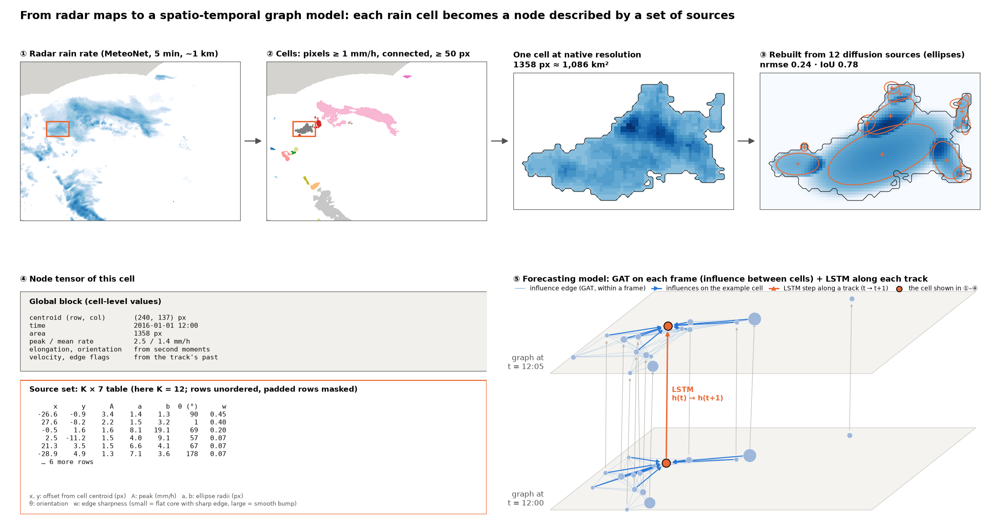

*The whole pipeline on real data (2016-01-01 12:00):*

1. *The radar rain-rate map.*
2. *Cells: connected pixels at ≥ 1 mm/h, at least 50 px.*
3. *One cell (orange box) at native resolution, and the same cell rebuilt from 12 fitted diffusion sources
   (ellipses = source extent, + = centre, black line = true 1 mm/h edge).*
4. *The node tensor of that cell: a global block plus its K × 7 source table (τ omitted, following the
   ablation in §7.5).*
5. *The forecasting model: one influence graph per frame (GAT; the influences on the example cell are
   highlighted), and an LSTM step along each track from 12:00 to 12:05.*

*Produced by `scripts/pipeline_figure.py`.*

### 1.3 Scope of this repository: the representation, and why it must be accurate

Neither the GAT nor the LSTM sees radar pixels. They only see one feature tensor per cell and per time
step. **Any information discarded at the representation stage is unavailable to the forecasting model.** The
representation therefore has to be highly descriptive and encode:

- **place:** position and size;
- **shape:** footprint, elongation, orientation, holes, edges;
- **intensity distribution:** where the rain is heavy and where it is light inside the cell.

The planned model sets the requirements:

| Requirement | Why the model needs it |
|---|---|
| **Descriptive** | The GAT needs it to judge interactions, and the LSTM to learn evolution. Both only see the representation. |
| **Compression, not prediction** | Forecasting belongs to the GAT + LSTM, so no dynamical assumption is built into the features. The goal is the most faithful summary of the cell's current state at a reasonable size. |
| **Measured by reconstruction** | If the cell can be rebuilt from its representation with small error, place, shape and intensity have all been retained. |
| **Decodable and differentiable** | The training loss compares *rendered* predictions with the radar, so the representation must map back to a rain field through a differentiable decoder. |
| **Stable along tracks** | The LSTM learns transitions from consecutive representations. If the description jumps while the rain barely changes, the LSTM has to learn noise. |
| **Order-free** | A cell's sources have no natural order, so they must be consumed by a permutation-invariant set encoder. |

---

## 2. Data

**MeteoNet** (Météo-France), radar rainfall product, north-west France, 2016–2018.

| Property | Value |
|---|---|
| Format | `.npz` per ~10 days; `data`: `int16`, shape `(T, 565, 784)` |
| Time step | 5 min |
| Grid | 0.01° (EPSG:4326); one pixel ≈ 1.1 × 0.75 km ≈ 0.8 km² |
| Value `R` | rain accumulated over the 5-min step, in hundredths of mm |
| Missing value | `-1` (outside radar coverage, ≈ 7.7 % of the grid) |

- **Rain rate:** `rate (mm/h) = R × 12 / 100`. The 5-min accumulation period is inferred from the time step.
- **Missing data is never treated as zero rain.** Doing so would create artificial dry areas and false cell
  boundaries along the coverage limit. Cells that touch missing data or the map edge are flagged as
  possibly truncated.
- **Loading check:** the map of 2016-01-01 12:00 was verified pixel by pixel against an independent Excel
  export.

---

## 3. Cell delimitation

Code: `src/cell_delimitation.py` — results: `archive/E0_segmentation_tracking/results/` ([E0 report](archive/E0_segmentation_tracking/report.md))

A cell is a **connected component of rainy pixels**. We use 8-connectivity, so diagonally oriented rain
bands are not fragmented by the grid. The key decision is which pixels count as rainy.

### 3.1 Threshold R > 0: rejected

If any non-zero value counts as rain, the map of 2016-01-01 12:00 contains:

- **one object holding 60 % of all rainy pixels** (51,900 px), made of several distinct rain areas joined
  by thin bridges of very light rain;
- **mostly 4–5 px specks** of drizzle elsewhere.

Switching to 4-connectivity leaves the giant object unchanged (51,878 px). The problem is the threshold, not
the connectivity.

### 3.2 Threshold 1 mm/h: retained

A pixel is rainy if its **rate is ≥ 1 mm/h** (`R ≥ 9`). The reasons:

- **Rain below 1 mm/h is uneventful.** It is drizzle or very light rain, of little hydrological interest and
  not what the model needs to reason about.
- **That faint rain is what connects distinct systems** into giant objects. Removing it separates them.
- **It removes most of the noise.** About ¾ of the pixels with R > 0 are below 1 mm/h, and these lowest
  values are the least reliable part of the radar estimate.

The threshold is deliberately the lowest one that separates systems. Higher thresholds split coherent
storms into fragments that appear and disappear as intensity fluctuates around the threshold.

| | R > 0 | **≥ 1 mm/h** |
|---|---|---|
| Cells at 12:00 / 12:05 / 12:10 | 166 / 167 / 167 | **52 / 48 / 42** |
| Rainy share of the grid | ≈ 19 % | ≈ 5 % |
| Largest object at 12:00 | 51,900 px (60 % of rain) | 10,904 px (51 %) |

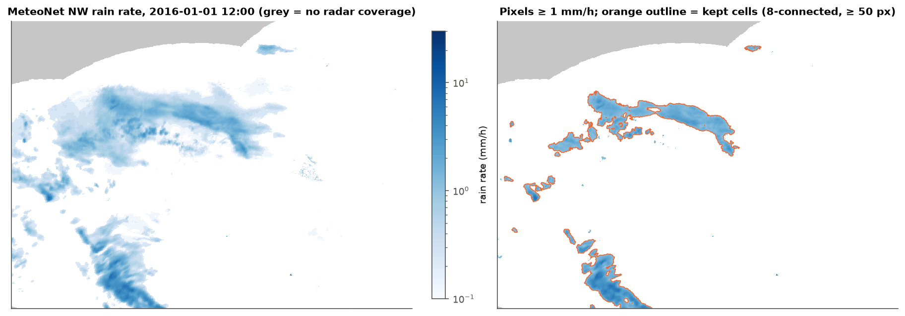

*Left: rain rate (log scale); grey = no radar coverage. Right: pixels ≥ 1 mm/h; orange outlines = cells kept.*

### 3.3 Additional rules

- **Large cells are kept whole,** with no watershed or multi-threshold splitting. A large coherent rain area
  is a real object, and splitting it would create artificial nodes. Large cells are handled at the
  representation stage instead, by giving them a larger description (Section 7).
- **Cells under 50 px (≈ 40 km²) are not analysed.** Their outline is dominated by pixelation, and they
  rarely persist from one map to the next.

Cells move little and coherently between consecutive maps (contours at 12:00 red, 12:05 green, 12:10 blue):

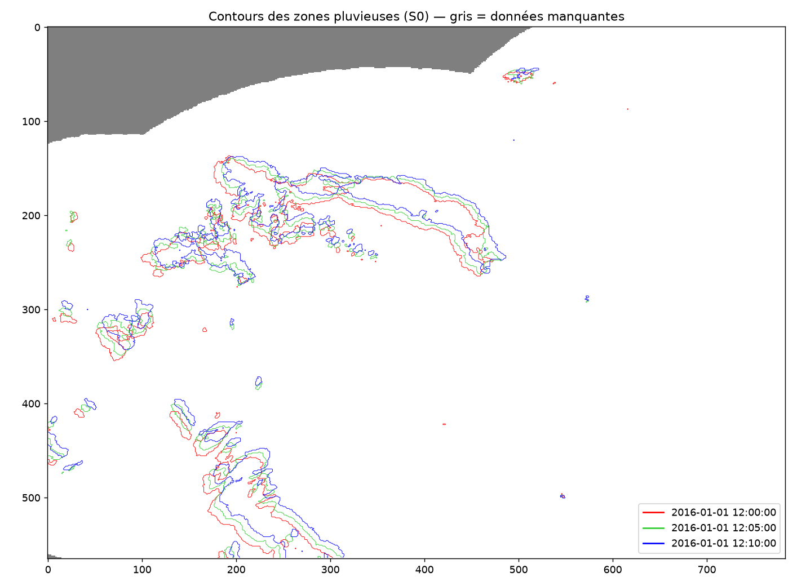

---

## 4. Tracking

Code: `src/track_cells.py` — results: `archive/E0_segmentation_tracking/results/T1_*`

Segmentation labels each map independently. Tracking assigns a persistent `track_id`. Each track is one
**input sequence for the LSTM** (§1.2), and tracking is also needed for the stability test (§7.6).

**Method:**

1. **Prediction:** each track is extrapolated at constant velocity.
2. **Link cost:** `0.5 × distance to the predicted position / 25 px + 0.5 × (1 − IoU of the shifted mask)`.
   Overlap is the reliable cue for large cells; distance is the reliable cue for small, fast ones.
3. **Assignment:** Hungarian algorithm (a global one-to-one assignment). Links costing more than 0.75 are
   rejected and become births or deaths, since a wrong identity is worse than a new track.
4. **Scope:** only cells of 50 px or more are tracked.

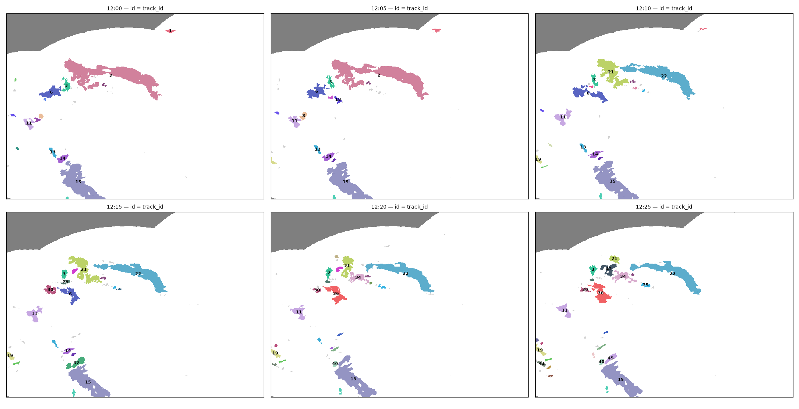

**Outcome:** large cells keep their identity over the six maps (30 min), including through several-fold
area changes. This is enough to build the cell pairs of the stability test.

**Not yet handled:**

- merges and splits (logged as a death plus a birth, with no parent/child table);
- exits through the map edge, which are not distinguished from decay;
- gap tolerance (a cell missed on one map gets a new id);
- quantitative validation (checks so far are visual only).

These gaps matter directly for the forecasting model, because each LSTM sequence is a track. A track broken
by a missed detection loses its history. A merge needs a rule to combine the two parents' hidden states, and
a split needs a rule for the children to inherit their parent's state. Completing the tracker is therefore a
prerequisite for the model, not a refinement.

---

## 5. Evaluation protocol

Each representation is decoded back into a rain field and compared with the radar field:

| Metric | Definition | Measures |
|---|---|---|
| **nrmse** (primary) | ‖x̂ − x‖ / ‖x‖ on √rate | overall fidelity |
| **IoU** | footprint overlap at 1 mm/h | shape and edges |
| **Mass error** | relative error on the total rain | amount of water |
| **Peak error** | relative error on the maximum rate | intense cores |

**Protocol choices:**

- **Errors on √rate.** Rain intensity is heavy-tailed, and a raw-rate error would be dominated by a few
  intense pixels.
- **Size bins.** Results are always reported in four bins: 50–200, 200–1,000, 1,000–5,000 and ≥ 5,000 px.
  Small showers and large fronts are different problems, and a global average is dominated by the many
  small cells.
- **Train/test split by day.** Maps 5 minutes apart are near-duplicates, so a random split leaks.
- **Equal storage budget.** Methods are compared at the same number of stored values.

---

## 6. Experiment 1 — fixed-length vectors

Code: `src/cell_dataset.py`, `src/compression_benchmark.py` — results: `archive/E1_fixed_vectors/results/` ([E1 report](archive/E1_fixed_vectors/report.md)); input `results/02_fixed_vector_benchmark/cells.npz`

### 6.1 Why diffusion

The initial idea was to describe a cell by the **parameters of a diffusion model**, by analogy with Dupire's
local-volatility model, where a diffusion coefficient is calibrated to reproduce an observed surface. Rain
cells look like intensity that has spread out from a few cores, peaking at the centre and decaying towards
the edges. Diffusion is the simplest physical process that produces such fields. A few sources plus a
spreading law could therefore replace thousands of pixels with a handful of interpretable parameters.

To test this, the diffusion decoder was compared with standard encodings under the usual node constraint:
**every cell is encoded as a vector of the same dimension d.**

*Background:* diffusion equation, heat kernel, Dupire's model, PCA, Zernike moments and autoencoders are
covered in [Further reading](#14-further-reading).

### 6.2 Set-up

- **Data:** 11,874 cells (≥ 50 px), one map per hour, from the first 10 days of January and July 2016.
- **Split:** days 1–7 for training (8,986 cells), days 8–10 for testing (2,888 cells).
- **Input:** each cell is centred in a square, resized to **32 × 32**, and stored as √rate.

| Method | Encoder → decoder |
|---|---|
| PCA | Linear projection on d components; the best linear baseline |
| Zernike | Least-squares projection on d Zernike polynomials |
| CNN autoencoder | 3 conv + 2 dense layers (≈ 0.7 M params) → learned transposed-conv decoder |
| Gaussian decoder | Same encoder → sum of d/6 anisotropic Gaussians (x, y, A, a, b, θ) |
| Diffusion decoder | Same encoder → point sources + a spatially varying diffusivity field (3 params) → 64 explicit diffusion steps |

The three neural methods share the same encoder, so any difference between them comes from the decoder alone.

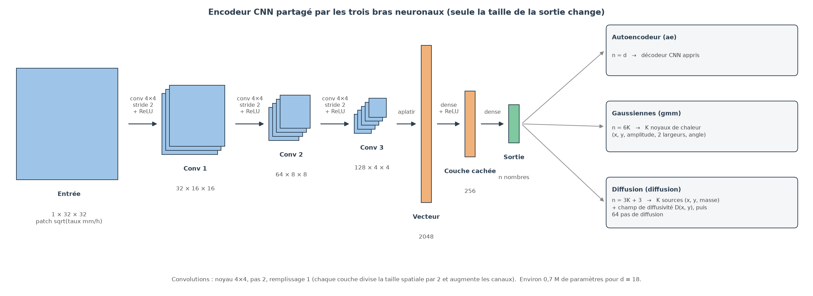

### 6.3 Results

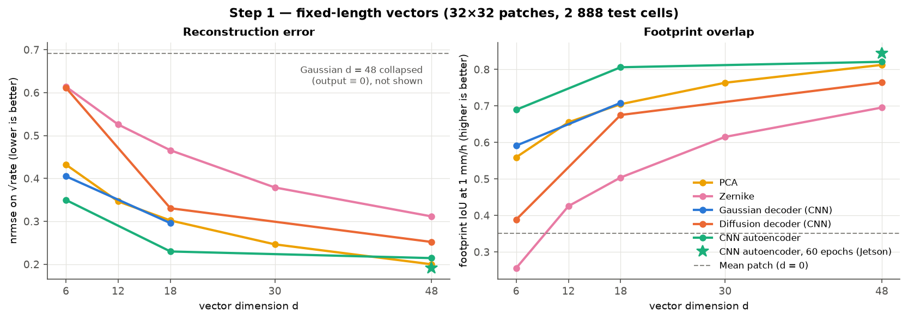

| nrmse | d = 6 | d = 18 | d = 48 |
|---|---|---|---|
| PCA | 0.432 | 0.302 | 0.200 |
| Zernike | 0.614 | 0.466 | 0.312 |
| Gaussian decoder | 0.405 | 0.296 | collapsed |
| Diffusion decoder | 0.611 | 0.331 | 0.252 |
| CNN autoencoder | **0.350** | **0.230** | 0.214 (25 ep.) → **0.191** (60 ep.) |

### 6.4 Takeaways

- **The learned autoencoder reconstructs best.** This is consistent with the literature on physics-based
  decoders: physical structure buys interpretability, not accuracy (Takeishi & Kalousis 2021).
- **Gaussians are the best physical decoder,** on par with PCA.
- **The global-diffusivity decoder is weak.** All sources share a single diffusivity field and a short
  diffusion time, so they cannot take individual shapes.
- **The Gaussian decoder at d = 48 collapsed** to a constant zero output at learning rates 2e-3 and 5e-4.
  The method was dropped.
- **Every method degrades with cell size.** The autoencoder at d = 48 scores 0.149 / 0.221 / 0.324 / 0.381
  by bin.

### 6.5 Why fixed-length vectors were abandoned

The size effect is structural. Resizing every cell to 32 × 32 and a fixed d:

- **destroys the internal detail of large cells** before encoding;
- **interpolates small cells** up to the patch size;
- **gives a 50 px shower and a 40,000 px front the same budget;**
- **keeps position and size outside the representation.**

A GAT node does not need to be a fixed-length vector. It can hold a **variable-size set**, processed by a
permutation-invariant set encoder. This removes the need for resizing and lets the description scale with
the cell.

---

## 7. Experiment 2 — variable-size source sets

Code: `src/variable_source_fit.py`, `src/stability_test.py`, `scripts/run_jetson.sh` — results:
`archive/E2_variable_sources/01_cpu_prelim/results/` (preliminary, [report](archive/E2_variable_sources/01_cpu_prelim/report.md)), `archive/E2_variable_sources/02_jetson_baseline/results/` (full study, [report](archive/E2_variable_sources/02_jetson_baseline/report.md))

### 7.1 Representation

Each cell is described **at native resolution** by a set of K sources, and the field is the sum of the
source contributions:

- **K grows with the complexity of the cell:** a few sources for a small shower, dozens for a front.
- **Positions are in map coordinates,** so place and size are part of the representation.
- **Each source is interpretable:** an intensity core with a position, amplitude, extent and orientation.

### 7.2 Source types

**Gaussian source, 6 parameters:** `x, y, A, a, b, θ`, with profile `A·exp(−r²/2)`, where `r` is the
elliptical radius. Gaussian cells are a classical rainfall model (Willems-type).

**Diffusion source, 8 parameters:** the same 6, plus `τ` (diffusion time) and `w` (edge sharpness). The
profile is the solution of a diffusion from a point source with a **source-relative diffusivity**:

```
D(r) = Dmax · τ · sigmoid((1 − r) / w) + floor
```

**Why diffusion, revisited.** Experiment 1 showed that a *shared* diffusivity field is too rigid, so
diffusion is now applied **per source**. The diffusivity is high inside the source ellipse and near zero
outside, so intensity spreads inside and stalls at the boundary:

- **small `w`** gives a **flat core with a sharp edge**;
- **large `w`** gives a smooth, Gaussian-like profile.

Rain cells thresholded at 1 mm/h typically have fairly uniform interiors and abrupt boundaries, which
Gaussian tails cannot represent with few components.

**Implementation:**

- **Precomputed profiles.** In the source frame the PDE depends only on `(τ, w)`. It is solved once on a
  24 × 16 grid and interpolated with `grid_sample`. This is exact up to interpolation, and avoids running a
  PDE solve per source and per iteration.
- **Windowed rendering.** Each source is rendered in a local window, which is about 12× faster.

*Background:* variable-diffusivity diffusion, edge-stopping diffusion (Perona–Malik), numerical solution of
the diffusion equation and differentiable interpolation are covered in [Further reading](#14-further-reading).

### 7.3 Fitting

Each cell is fitted **directly** by gradient descent (Adam), with no encoder. This measures what each source
family can express, independently of the quality of a learned encoder.

- **Progressive addition.** Sources are added in waves at the peaks of the residual, with
  K ∈ {1, 2, 3, 4, 6, 8, 12, 16, 24, 32, 48, 64}. All parameters are re-optimised after each wave.
- **Cap on K per size bin:** 8 / 24 / 48 / 64.
- **Target:** √rate on the bounding box plus a 3-px zero margin, which penalises overflow outside the cell.

### 7.4 Experimental programme

A preliminary CPU run (two small bins) already favoured diffusion sources. The full programme was then run
as one **7.5-h session on an NVIDIA Jetson Orin Nano**:

| Step | Question | Cells |
|---|---|---|
| 1 Main | Gaussian vs diffusion at equal parameter budget | 160 (40 per bin), Jan + Jul 2016 |
| 2 Stability | Is the same cell described the same way 5 min later? | 100 pairs (25 per bin) |
| 3 Ablation | Which of `τ`, `w` matters? | same 160 |
| 4 Generalisation | Does it hold on another season and year? | 160, Apr + Sep 2017 |
| 5 Restarts | Does it depend on the initialisation? | same 160 |
| 6–7 | Re-runs of Experiment 1 (Gaussian d = 48, autoencoder with 60 epochs) | 2,888 |

### 7.5 Results

#### Step 1 — Main comparison

Comparisons are at **equal parameter budget**, since storage per node is what matters. At equal budget,
diffusion uses fewer sources (8 parameters each against 6).

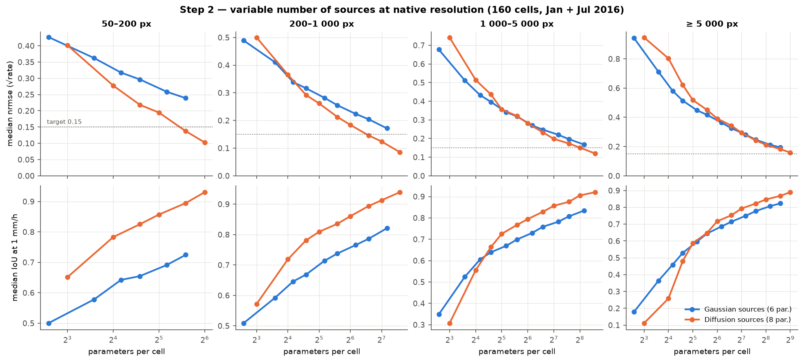

Median nrmse, Gaussian / diffusion; the share of cells where diffusion is better is in brackets:

| Bin | 24 par. | 48 par. | 96 par. | 192 par. | 384 par. |
|---|---|---|---|---|---|
| 50–200 px | 0.296 / **0.218** (95 %) | 0.239 / **0.137** (100 %) | | | |
| 200–1,000 px | 0.316 / **0.292** (70 %) | 0.255 / **0.213** (93 %) | 0.204 / **0.146** (98 %) | | |
| 1,000–5,000 px | **0.397** / 0.436 (35 %) | **0.319** / 0.321 (43 %) | 0.247 / **0.233** (70 %) | 0.196 / **0.173** (93 %) | |
| ≥ 5,000 px | **0.514** / 0.621 (18 %) | **0.417** / 0.450 (18 %) | **0.325** / 0.343 (23 %) | 0.247 / **0.242** (40 %) | 0.194 / **0.182** (63 %) |

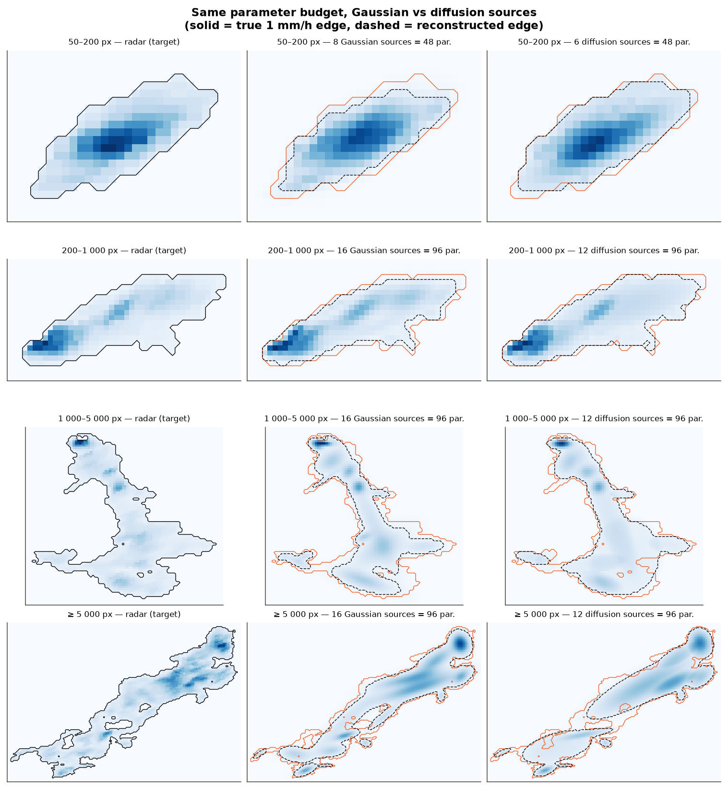

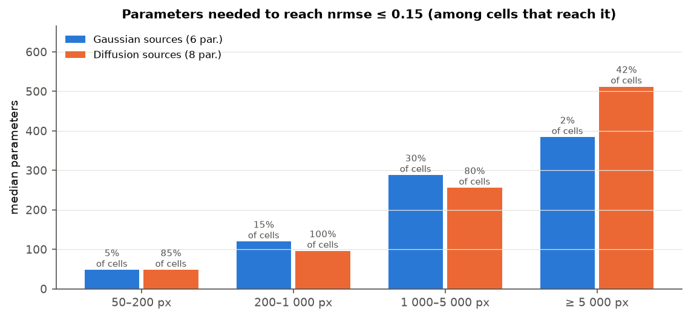

**Takeaways:**

- **Diffusion sources are clearly better on small and medium cells,** despite their higher cost per source.
  At 48 parameters on small cells: 0.137 vs 0.239, better on all 40 cells.
- **The gain is mainly in shape.** IoU is 0.90 vs 0.73 on small cells and 0.89 vs 0.79 on medium cells.
  Mass error at the highest K is 1–3 %.
- **Reaching nrmse ≤ 0.15:** diffusion reaches it for 85 % / 100 % / 80 % of cells in the first three bins,
  against 5 % / 15 % / 30 % for Gaussians.
- **On large cells, Gaussians win at low budgets,** and diffusion overtakes them only around 200 parameters.
  At equal *number of sources*, diffusion is better from K ≈ 6 in every bin. The deficit therefore comes from
  the price of each source, not from its shape: large cells need many sources, and cheaper sources buy more
  of them.
- **Cells ≥ 5,000 px remain hard** (median 8,900 px, max 48,900 px). With 512 parameters, only 42 % reach
  0.15, and this bin used about 60 % of the compute.

#### Step 3 — Ablation of `τ` and `w`

Same cells, refitted with only one of the two extra parameters free (7 parameters per source):

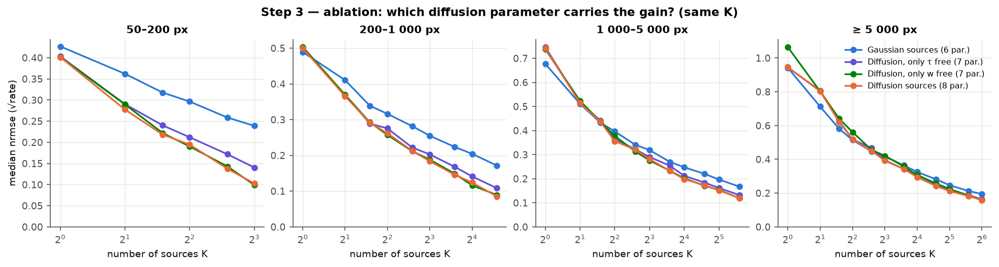

| Median nrmse, max K | K | only `τ` free | only `w` free | both free | Gaussian |
|---|---|---|---|---|---|
| 50–200 px | 8 | 0.140 | **0.099** | 0.103 | 0.239 |
| 200–1,000 px | 24 | 0.108 | 0.089 | **0.085** | 0.172 |
| 1,000–5,000 px | 48 | 0.132 | **0.120** | **0.120** | 0.167 |
| ≥ 5,000 px | 64 | 0.164 | **0.158** | 0.159 | 0.194 |

**Takeaways:**

- **The edge sharpness `w` alone matches the full model.** `τ` alone is clearly worse and adds nothing once
  `w` is free. `τ` mostly controls the spread of the profile, which the radii and amplitude already encode.
- **The value of the diffusion formulation lies in the profile family it generates,** from a smooth bump to
  a plateau with a steep edge, not in the diffusion time.
- **Decision:** use **7-parameter sources** `(x, y, A, a, b, θ, w)`. This removes a redundant degree of
  freedom and halves the extra cost per source relative to Gaussians, which also helps on large cells.

#### Step 4 — Another season and year (Apr + Sep 2017)

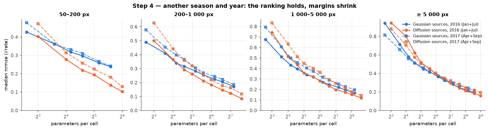

**Takeaways:**

- **The ranking holds.**
  - Small cells, 48 parameters: 0.181 vs 0.241 (diffusion better on 93 %).
  - Medium cells, 96 parameters: 0.178 vs 0.223 (85 %).
- **Margins are smaller, and large cells tie** even at 384 parameters (0.217 vs 0.215). The 2017 large cells
  are much bigger: median 16,100 px vs 8,900 px in 2016.
- The result is not specific to the months sampled, but its strength depends on the distribution of cell sizes.

#### Step 5 — Restarts with a perturbed initialisation

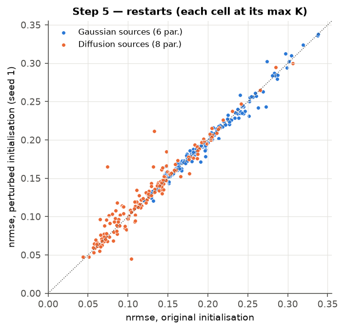

**Takeaways:**

- **The fits are reproducible.** At each cell's max K, per-cell nrmse correlates at 0.88–0.998 between the
  two runs, with a median absolute difference of 0.002–0.010.
- **Keeping the best of two fits gives a median gain of 0.** The optimiser is not the bottleneck, and
  multiple restarts are not needed.

### 7.6 Step 2 — Temporal stability

**Protocol:**

1. **Pairs:** the same cell at t and t + 5 min (mutual best match, IoU ≥ 0.5), 25 pairs per bin.
2. **Fits:** both frames are fitted with the same K (3 / 6 / 12 / 24 by bin).
3. **Matching:** the two source sets are matched with the Hungarian algorithm on scale-free descriptors
   (position and radii normalised by the cell's equivalent radius, log-amplitude, angle, plus `τ` and `w`).
4. **Score:** the matching cost divided by the cost of matching against a *different* cell of the same bin.
   A score of 0 means identical descriptions, and 1 means no more similar than an unrelated cell.

*Background:* Hungarian algorithm, label switching in mixture models and permutation-invariant set encoders
are covered in [Further reading](#14-further-reading).

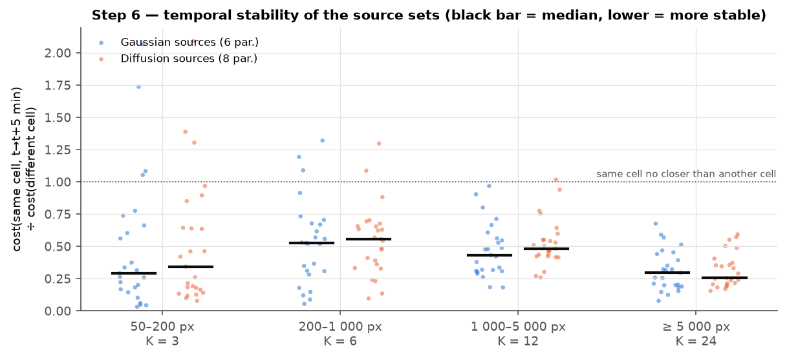

| Bin | Median ratio (Gaussian / diffusion) | Same cell closer than a different cell |
|---|---|---|
| 50–200 px | 0.29 / 0.34 | 84 % / 88 % |
| 200–1,000 px | 0.53 / 0.56 | 88 % / 92 % |
| 1,000–5,000 px | 0.43 / 0.48 | 100 % / 96 % |
| ≥ 5,000 px | 0.30 / 0.26 | 100 % / 100 % |

**Takeaways:**

- **The source set identifies the cell.** In 84–100 % of pairs, a cell's description is closer to itself
  5 minutes later than to another cell.
- **Individual sources are not persistent.** Matched sources drift by about 0.3 equivalent radii in
  position and about 0.3 in log-amplitude, which is more than the rain itself changes. Mixture fits are
  non-identifiable: several arrangements explain the same field almost equally well, and independent fits
  land on different ones.
- **Both source types behave similarly.** Gaussians score slightly better in the three smaller bins, partly
  because diffusion is compared on two extra parameters (`τ`, `w` add 0.3–0.4 to the cost). On the shared
  parameters the drift is similar, and on the largest cells diffusion is more stable.
- **Better fits are not more stable** (correlation 0.04–0.5).

**Implications:**

- **Sources must be consumed as an unordered set** by a permutation-invariant node encoder, with no
  index-wise comparison.
- **The forecasting loss must be computed in field space** (rendered prediction vs radar at t+1). A loss on
  source parameters would penalise valid alternative arrangements of the same rain.
- **Fits should be warm-started from the previous frame's sources,** shifted by the tracked velocity, so that
  sources evolve continuously along a track. This gives the LSTM smoother sequences to learn from.

---

## 8. Discussion

**What the study establishes:**

1. **A variable-size source set is a better node representation than a fixed vector.** It preserves
   position, size and native-resolution detail, scales with the complexity of the cell, and has
   interpretable parameters.
2. **The source profile matters more than its physical origin.** Thresholded rain cells have flat cores and
   sharp edges. A profile family with adjustable edge sharpness captures this; Gaussians do not. The
   diffusion formulation produced that family, and the ablation shows that one shape parameter does the work.
3. **The result is robust** to initialisation and to a change of season and year. It is clearest below
   5,000 px, where most cells are.

**What remains open:**

- **Very large cells** need hundreds of parameters, and there the two source types are close.
- **Source persistence over time** is insufficient for the LSTM, which learns from consecutive
  representations. Field-space training and warm-started fits are the planned remedies.
- **Per-cell optimisation is too slow for the full dataset:** 7.5 GPU-hours for a few hundred cells.

**Autoencoder vs sources.** At 48 values the autoencoder scores 0.149 / 0.221 / 0.324 / 0.381 by bin, close
to diffusion sources at 48 parameters (0.137 / 0.213 / 0.321 / 0.450). The comparison is not like-for-like:

- **The autoencoder is scored on 32 × 32 downsampled patches,** which removes the large-cell detail the
  sources must reproduce at native resolution.
- **Its size is fixed,** and its code is not interpretable.
- **It is amortised** (one forward pass per cell), whereas the source fits are per-cell optimisations.

---

## 9. Decision log

| # | Decision | Reason | § | Evidence |
|---|---|---|---|---|
| D0 | Core objective: forecast each cell's position, shape and intensity from its own history and the influence of surrounding cells | The dynamics of rain are driven by cell lifecycles and interactions | 1.1 | [§1.1](#11-core-objective) |
| D1 | Missing data (`-1`) is never treated as dry | Avoids false dry areas and false cell edges | 2 | [E0 report](archive/E0_segmentation_tracking/report.md) |
| D2 | Rainy pixel = rate ≥ 1 mm/h, 8-connectivity | Lighter rain is uneventful and merges distinct systems | 3.2 | [E0 report](archive/E0_segmentation_tracking/report.md) |
| D3 | Large cells kept whole | They are real objects; size is handled by a larger description | 3.3 | [E0 report](archive/E0_segmentation_tracking/report.md) |
| D4 | Cells < 50 px ignored | Shape dominated by pixelation; short-lived | 3.3 | [E0 report](archive/E0_segmentation_tracking/report.md) |
| D5 | Representation = compression, not prediction | Forecasting belongs to the GAT + LSTM; no information should be lost here | 1.3 | [E1 report](archive/E1_fixed_vectors/report.md) |
| D6 | Evaluate by reconstruction | Direct check that place, shape and intensity are retained | 1.3 | [E1 report](archive/E1_fixed_vectors/report.md) |
| D7 | Errors on √rate, reported by size bin, split by day, equal budget | Fair, leak-free comparison not dominated by peaks or small cells | 5 | [E1 report](archive/E1_fixed_vectors/report.md) |
| D8 | Drop the fixed-length vectors | Resizing destroys large-cell detail and drops position and size | 6.5 | [E1 report](archive/E1_fixed_vectors/report.md) |
| D9 | Node = variable-size source set at native resolution | Description scales with the cell; interpretable | 7.1 | [E2 CPU report](archive/E2_variable_sources/01_cpu_prelim/report.md) |
| D10 | Per-source diffusion profile instead of Gaussian | Lower error and much better footprint at equal budget | 7.5 | [E2 Jetson report](archive/E2_variable_sources/02_jetson_baseline/report.md) |
| D11 | Drop `τ`, keep `w` (7 parameters per source) | `τ` is redundant; `w` carries the gain | 7.5 | [E2 Jetson report](archive/E2_variable_sources/02_jetson_baseline/report.md) |
| D12 | Drop the Gaussian fixed-vector decoder | Collapsed at two learning rates | 6.4 | [E1 report](archive/E1_fixed_vectors/report.md) |
| D13 | Run heavy experiments on a Jetson Orin Nano | The development machine has no usable GPU | 7.4 | [E2 CPU report](archive/E2_variable_sources/01_cpu_prelim/report.md) |
| D14 | *(planned)* Graph edges = influence between cells **within a frame**, with relative-geometry edge features | Interaction is spatial; time is handled by the LSTM; plain GAT attention ignores geometry | 1.2 | [§1.2](#12-planned-forecasting-model-gat-within-frames-lstm-along-tracks) |
| D15 | *(planned)* Temporal dynamics learned by an LSTM along each track | Each cell's evolution is a sequence; a standard, well-tested design for interacting agents (Social-LSTM, STGAT) | 1.2 | [§1.2](#12-planned-forecasting-model-gat-within-frames-lstm-along-tracks) |
| D16 | *(planned)* Train with a field-space loss through the differentiable renderer | Source sets are non-identifiable, so source-by-source losses are ill-posed | 1.2, 7.6 | [§1.2](#12-planned-forecasting-model-gat-within-frames-lstm-along-tracks); [stability, E2 Jetson report](archive/E2_variable_sources/02_jetson_baseline/report.md) |
| D17 | Adopt the 7-parameter source `diff7` (`τ` fixed at 0.5) in code | Same error with 12.5 % fewer parameters; per-K gap ≤ 0.005 except on ≥ 5,000 px cells at K ≤ 24 | 9 | [E3 report](archive/E3_diff7_convergence/report.md) |
| D18 | diff7 `w` table: 0.02–0.5, 16 log-spaced nodes | A wider 0.005–0.5 table reduced pile-up at the sharp edge but made medium cells worse | 9 | [E3 report](archive/E3_diff7_convergence/report.md) |
| D19 | 200 Adam iterations per wave below 1,000 px, 500 at 1,000 px and above | Gain 200 → 500 is < 0.005 below 1,000 px and ≈ 0.007 above; 2,000 is never better than 500 | 9 | [E3 report](archive/E3_diff7_convergence/report.md) |

**Node layout under consideration** (panel ④ of the pipeline figure in §1.2):

1. **Global block (~15 values):** position, time, area, bounding box, total and peak rain, orientation,
   elongation, edge and missing-data flags, and velocity estimated from the track's past only.
2. **Source set:** K × 7 `(x, y, A, a, b, θ, w)`, with positions relative to the centroid. The rows are
   unordered and padding rows are masked.
3. **Optional learned residual:** only if the sources leave a large, structured error.

---

## 10. Limitations

- **Sample sizes.** 40 cells per bin for the fits and 25 pairs per bin for stability. Medians are reliable,
  but small differences should not be over-interpreted.
- **Data coverage.** Four months over two years, in a single region.
- **Direct fitting is an upper bound.** A learned source encoder will do somewhat worse.
- **The tracker is preliminary** (Section 4). Merges, splits and missed detections directly affect the
  LSTM sequences.
- **The forecasting model is not built yet.** The requirements in §1.3 are derived from its planned design
  and will be revisited once it is trained.
- **Units.** The 5-min accumulation period of `R` is inferred from the time step. If it were different, the
  1 mm/h threshold would shift by a constant factor.

---

## 11. Next steps

1. ~~**Switch to 7-parameter sources** in the fitting code.~~ Done: arm `diff7`, with the iteration counts of D19
   ([E3 report](archive/E3_diff7_convergence/report.md)). Open points from E3:
   - test a decaying learning rate, since 2,000 iterations per wave is worse than 500;
   - 23 % of sources sit at the sharpest `w`, which looks like an optimisation effect.
2. **Choose K per cell from a target error** instead of a cap per size bin. Median parameters to reach 0.15:
   - 16–48 for small cells;
   - ~96 for medium cells;
   - ~256 for 1,000–5,000 px;
   - ≥ 512 for the largest.

   Relaxing the target to 0.2 on the largest cells roughly halves their cost.
3. **Warm-start fits along tracks,** then repeat the stability test.
4. **Train an amortised source encoder,** for example a fully convolutional detector pre-trained on
   synthetic cells and followed by a short refinement fit, to process the full dataset.
5. **Complete the tracker,** a prerequisite for the LSTM sequences: merge/split events with a parent
   table, edge entries and exits, and a one-frame gap tolerance.
6. **Re-score the autoencoder at native resolution** for a fair comparison.
7. **Build the forecasting model:**
   - a permutation-invariant set encoder per node;
   - an influence graph per frame (GAT), with relative-geometry edge features;
   - an LSTM along each track, with hidden-state rules for births, merges and splits;
   - a field-space loss through the differentiable renderer;
   - a comparison of the "GAT then LSTM" and STGAT orderings;
   - evaluation against persistence, advection and LSTM-without-GAT baselines.

---

## 12. Repository and reproduction

```
.
├── README.md
├── requirements.txt
├── requirements-dev.txt           # test tools (pytest, pytest-cov)
├── pyproject.toml                 # pytest configuration
├── DATA/                          # MeteoNet raw data (not versioned, 5.6 GB)
├── src/
│   ├── cell_delimitation.py       # loading, 1 mm/h segmentation, per-cell features   → results/01
│   ├── track_cells.py             # tracker                                           → results/01
│   ├── cell_dataset.py            # 64×64 patch dataset (Experiment 1)                → results/02/cells.npz
│   ├── compression_benchmark.py   # Experiment 1                                      → results/02
│   ├── variable_source_fit.py     # Experiment 2, source fits (default arm diff7, D17; 200/500 iterations per wave by size, D19)
│   ├── profile_lut.py             # diffusion profile tables (default, and log-spaced w for diff7)
│   ├── arm_comparison.py          # paired diff7 vs diffusion comparison, w pile-up, reproduction check
│   ├── convergence_check.py       # iterations per wave (E3)
│   └── stability_test.py          # Experiment 2, temporal stability                  → results/04/stability
├── scripts/
│   ├── build_samples.py           # rebuilds the non-versioned inputs from DATA/ (--logw: diff7 tables)
│   ├── run_jetson.sh              # the 7-step GPU session (Section 7.4)
│   ├── run_jetson_diff7.sh        # the E3 GPU session (diff7, w tables, convergence)
│   ├── make_figures.py            # result figures of this report → docs/figures/
│   └── pipeline_figure.py         # pipeline overview figure (§1.2) → docs/figures/00_pipeline.png
├── tests/                         # pytest: archive layout, figure inputs (unit and integration markers)
├── tools/                         # data inspection helpers
├── docs/
│   └── figures/                   # all figures of this report (generated)
├── archive/                       # finished experiments: outputs, reports, code pinned by tag v0-jetson-baseline
│   ├── README.md                  # index: experiment → question → decisions → report
│   ├── E0_segmentation_tracking/  # results/, report.md
│   ├── E1_fixed_vectors/          # results/, report.md
│   └── E2_variable_sources/
│       ├── 01_cpu_prelim/         # results/, report.md (CPU preliminary run)
│   │   └── 02_jetson_baseline/    # results/, report.md (full Jetson programme)
│   └── E3_diff7_convergence/      # results/, report.md (diff7, w tables, iterations per wave; tag v1-diff7-convergence)
└── results/                       # git-ignored: rebuildable inputs + new runs (see results/README.md)
    ├── 01_segmentation_tracking/  # new runs (archived outputs: archive/E0_segmentation_tracking/)
    ├── 02_fixed_vector_benchmark/ # input cells.npz; new runs
    ├── 03_variable_sources/       # inputs (sample_*.pkl, stability_pairs_25.pkl, diffusion_profiles.pt); new runs
    └── 04_jetson_run/             # new runs: main/ ablation/ season2017/ restart_seed1/ stability/ logs/
```

**Contents of each run folder in `archive/E2_variable_sources/02_jetson_baseline/results/`:**

- `fits_<bin>.csv`: one row per cell × source type × K, with nrmse, IoU, mass and peak errors;
- two summary tables;
- `snapshots.pkl`: example reconstructions.

Code comments and logs are in French.

```bash
conda create -n gat python=3.12 && conda activate gat
pip install -r requirements.txt

python scripts/build_samples.py        # needs MeteoNet in DATA/NW_rainfall_<year>/rainfall-NW-<year>-<month>/

python src/cell_delimitation.py --start "2016-01-01 12:00" --n-frames 3
python src/track_cells.py --start "2016-01-01 12:00" --n-frames 6

python src/compression_benchmark.py --arms mean pca zernike ae diffusion --dims 6 12 18 30 48   # ≈ 1.5 h CPU (gmm arm removed, see D12)

bash scripts/run_jetson.sh             # Experiment 2, ≈ 7.5 h on a Jetson Orin Nano (PY, DEV overridable)

python scripts/make_figures.py
python scripts/pipeline_figure.py     # needs DATA/ (fits one example cell, ~10 s)
```

**Environment:**

- **Development:** macOS 12, CPU only, Python 3.15, PyTorch 2.15.
- **GPU runs:** Jetson Orin Nano 8 GB, JetPack 7.2 (L4T R39), CUDA 13.2, Python 3.12, PyTorch 2.15.

On JetPack 7.x, NVIDIA's JetPack 6 wheels do not apply. Install the standard CUDA build with
`pip install torch --index-url https://download.pytorch.org/whl/cu132`. A warning about compute capability
8.7 vs 8.0 is harmless.

---

## 13. References

- Takeishi, N. & Kalousis, A. (2021). *Physics-Integrated Variational Autoencoders for Robust and
  Interpretable Generative Modeling.* arXiv:2102.13156.
- Lu, P. Y., Kim, S. & Soljačić, M. (2020). *Extracting Interpretable Physical Parameters from
  Spatiotemporal Systems using Unsupervised Learning.* Phys. Rev. X 10, 031056.
- Preechakul, K. et al. (2022). *Diffusion Autoencoders: Toward a Meaningful and Decodable Representation.* CVPR.
- Willems-type stochastic rainfall models with Gaussian rain cells, e.g. EGU2018-9551.
- Leinonen, J. et al. (2023). *Latent diffusion models for generative precipitation nowcasting* (LDCast),
  arXiv:2304.12891.
- Gong, J. et al. (2024). *CasCast*, arXiv:2402.04290.
- CNGAT, IEEE Xplore 9570292: a graph attention network on radar echo fields.

We found no prior work that compresses individual rain cells with a physical diffusion model.

---

## 14. Further reading

The report doesn't derive the mathematics. If a concept is unfamiliar, these are standard entry points.

### Diffusion

| Topic | Where it is used | Read |
|---|---|---|
| Diffusion (heat) equation | §6–7: diffusion decoder and diffusion sources | [Heat equation](https://en.wikipedia.org/wiki/Heat_equation); Crank, J. (1975), *The Mathematics of Diffusion*, Oxford University Press |
| Heat kernel: why diffusion from a point source with constant diffusivity gives a Gaussian | §7.2: Gaussian sources as the constant-D special case | [Heat kernel](https://en.wikipedia.org/wiki/Heat_kernel) |
| Diffusion with variable diffusivity ∇·(D∇u) | §7.2: source-relative `D(r)` | Crank (1975), chapters on variable diffusion coefficients |
| Edge-stopping diffusion (diffusivity that drops at boundaries) | §7.2: low `D` outside the ellipse produces sharp edges | Perona, P. & Malik, J. (1990), *Scale-space and edge detection using anisotropic diffusion*, IEEE TPAMI 12(7); [Anisotropic diffusion](https://en.wikipedia.org/wiki/Anisotropic_diffusion) |
| Numerical solution: explicit finite differences, stability limit | §6.2 (64 explicit steps), §7.2 (precomputed profiles) | [FTCS scheme](https://en.wikipedia.org/wiki/FTCS_scheme); LeVeque, R. J. (2007), *Finite Difference Methods for Ordinary and Partial Differential Equations*, SIAM |
| Dupire local-volatility model | §6.1: origin of the diffusion idea | Dupire, B. (1994), *Pricing with a smile*, Risk 7(1); [Local volatility](https://en.wikipedia.org/wiki/Local_volatility) |
| Generative "diffusion models" in ML: a different concept, not used here | §13 references (LDCast, CasCast) | Ho, J., Jain, A. & Abbeel, P. (2020), *Denoising Diffusion Probabilistic Models*, arXiv:2006.11239 |

### Representations and fitting

| Topic | Where it is used | Read |
|---|---|---|
| Principal component analysis | §6: linear baseline | Jolliffe, I. T. (2002), *Principal Component Analysis*, Springer; [PCA](https://en.wikipedia.org/wiki/Principal_component_analysis) |
| Zernike moments as shape descriptors | §6 | Khotanzad, A. & Hong, Y. H. (1990), *Invariant image recognition by Zernike moments*, IEEE TPAMI 12(5); [Zernike polynomials](https://en.wikipedia.org/wiki/Zernike_polynomials) |
| Autoencoders | §6 | Hinton, G. E. & Salakhutdinov, R. R. (2006), *Reducing the dimensionality of data with neural networks*, Science 313; Goodfellow, Bengio & Courville (2016), *Deep Learning*, ch. 14 ([deeplearningbook.org](https://www.deeplearningbook.org/)) |
| Gaussian mixtures and label switching (why source order is arbitrary and fits are non-identifiable) | §7.6: stability | Bishop, C. M. (2006), *Pattern Recognition and Machine Learning*, ch. 9; Stephens, M. (2000), *Dealing with label switching in mixture models*, JRSS B 62(4) |
| Adam optimiser | §7.3: direct fitting | Kingma, D. P. & Ba, J. (2015), *Adam: A Method for Stochastic Optimization*, arXiv:1412.6980 |
| Differentiable grid interpolation (`grid_sample`) | §7.2: lookup-table rendering | Jaderberg, M. et al. (2015), *Spatial Transformer Networks*, arXiv:1506.02025 |
| Physics-based decoders vs learned decoders | §6.4, §8 | Takeishi & Kalousis (2021) and Lu et al. (2020), see §13 |

### Segmentation, tracking and matching

| Topic | Where it is used | Read |
|---|---|---|
| Connected-component labelling, 4- vs 8-connectivity | §3 | [Connected-component labeling](https://en.wikipedia.org/wiki/Connected-component_labeling); `scipy.ndimage.label` documentation |
| Hungarian algorithm (optimal one-to-one assignment) | §4 (tracking), §7.6 (matching source sets) | Kuhn, H. W. (1955), *The Hungarian method for the assignment problem*, Naval Research Logistics Quarterly 2; [Hungarian algorithm](https://en.wikipedia.org/wiki/Hungarian_algorithm) |
| IoU (Jaccard index) | §4, §5 | [Jaccard index](https://en.wikipedia.org/wiki/Jaccard_index) |
| Radar nowcasting, cell tracking, persistence and advection baselines | §4, §11 | Prudden, R. et al. (2020), *A review of radar-based nowcasting of precipitation and applicable machine learning techniques*, arXiv:2005.04988 |
| MeteoNet data format and units | §2 | [MeteoNet documentation](https://meteonet.umr-cnrm.fr/) |

### Graph models

| Topic | Where it is used | Read |
|---|---|---|
| Graph Attention Networks | §1.2, §11 | Veličković, P. et al. (2018), *Graph Attention Networks*, ICLR, arXiv:1710.10903 |
| Edge features in attention / message passing (relative geometry on edges) | §1.2 | Gilmer, J. et al. (2017), *Neural Message Passing for Quantum Chemistry*, arXiv:1704.01212; Brody, S., Alon, U. & Yahav, E. (2022), *How Attentive are Graph Attention Networks?* (GATv2), arXiv:2105.14491 |
| LSTM | §1.2 | Hochreiter, S. & Schmidhuber, J. (1997), *Long Short-Term Memory*, Neural Computation 9(8) |
| Interaction graph + LSTM for moving agents (the closest model family) | §1.2 | Alahi, A. et al. (2016), *Social LSTM: Human Trajectory Prediction in Crowded Spaces*, CVPR; Huang, Y. et al. (2019), *STGAT: Modeling Spatial-Temporal Interactions for Human Trajectory Prediction*, ICCV |
| Permutation-invariant set encoders (variable-size source sets as node features) | §7.6, §9, §11 | Zaheer, M. et al. (2017), *Deep Sets*, arXiv:1703.06114; Lee, J. et al. (2019), *Set Transformer*, arXiv:1810.00825 |

---

## 15. Glossary

### Data and meteorology

| Term | Definition |
|---|---|
| **MeteoNet** | Open meteorological dataset published by Météo-France; we use its radar rainfall product for north-west France |
| **`R`** | Raw radar value: rain accumulated during one 5-min step, in hundredths of a millimetre |
| **Rain rate** | Rain intensity in mm/h, `R × 12 / 100` |
| **Missing pixel** | Pixel with value `-1`: not observed by the radar (outside coverage). Distinct from a dry pixel (`0`) |
| **Uneventful rain** | Rain below 1 mm/h (drizzle, very light rain), excluded from the cells |
| **Stratiform / convective rain** | Widespread, fairly uniform rain (fronts) / localised, intense showers and storms |
| **Native resolution** | The original radar grid (0.01°, ≈ 0.8 km² per pixel), without any resizing |
| **Frame** | One radar map at one time step |

### Cells and tracking

| Term | Definition |
|---|---|
| **Rainy pixel** | Valid pixel with rain rate ≥ 1 mm/h |
| **Rain cell** | Connected group of rainy pixels (8-connectivity) with an area of at least 50 px |
| **8-connectivity / 4-connectivity** | Two pixels are neighbours if they share an edge or a corner / an edge only |
| **Segmentation** | Splitting a radar map into cells |
| **S0, S1, S2** | Segmentation variants tested: `R > 0` with 8-connectivity / `R > 0` with 4-connectivity / ≥ 1 mm/h with 8-connectivity (retained). Output files keep these prefixes |
| **Giant object** | A single component covering most of the rainy area, produced when the threshold is too low |
| **Area (px)** | Number of pixels in a cell; 1 px ≈ 0.8 km² |
| **Size bin** | One of the four area classes used to report results: 50–200, 200–1,000, 1,000–5,000 and ≥ 5,000 px |
| **Border / missing-neighbour flag** | Marks a cell touching the map edge / a missing-data zone, and therefore possibly truncated |
| **Tracking** | Linking the same cell across consecutive frames |
| **Track, `track_id`** | The sequence of observations of one cell over time, and its persistent identifier |
| **T1** | The tracker used here: constant-velocity prediction, distance + IoU cost, Hungarian assignment |
| **Birth / death** | A cell that appears with no predecessor / a track that ends with no successor |
| **Merge / split** | Two cells becoming one / one cell becoming two (not yet modelled) |

### Representation

| Term | Definition |
|---|---|
| **Core objective** | Forecasting each cell's next position, shape and intensity from its history and the influence of surrounding cells |
| **Representation** | The numbers stored for one cell at one time step, used as its node features |
| **Node** | A rain cell at one time step |
| **Influence edge** | A link between two cells of the same frame, along which the GAT exchanges information. It carries the relative geometry of the two cells; its attention weight is the learned influence |
| **Interaction graph** | The graph of one radar frame: nodes = cells present, edges = candidate influences |
| **Node embedding** | The fixed-size vector produced for a cell by the node encoder, then updated by the GAT |
| **Track sequence** | The ordered sequence of one cell's embeddings along its track; the input of the LSTM |
| **LSTM** | Recurrent network that reads a track sequence and learns the transition from t to t+1 through a hidden state `h(t)` |
| **Spatio-temporal graph network** | A model combining interaction within each frame (GAT) and dynamics over time (LSTM) |
| **Field-space loss** | Training loss computed on the rendered rain field (prediction vs radar), not on source parameters |
| **Global block** | Part of the node holding cell-level quantities: position, area, total and peak rain, orientation, flags, velocity |
| **Fixed-length vector** | Experiment 1: every cell encoded with the same number d of values |
| **Patch** | The square, resized image of a cell (32 × 32) used in Experiment 1 |
| **Arm** | One of the methods compared in an experiment (e.g. PCA, Gaussian sources, diffusion sources) |
| **Decoder (physical / learned)** | Function rebuilding the rain field from the representation: a fixed physical model (Gaussians, diffusion) / a trained network |
| **Source** | Elementary intensity core; a cell is represented as the sum of its sources |
| **K** | Number of sources used for a cell |
| **Source set** | The K × (parameters per source) table describing a cell. Its rows are unordered |
| **Gaussian source** | Source with profile `A·exp(−r²/2)`; 6 parameters `x, y, A, a, b, θ` |
| **Diffusion source** | Source whose profile is the solution of a diffusion with source-relative diffusivity `D(r)`; 8 parameters, or 7 without `τ` |
| **`x, y`** | Position of the source centre |
| **`A`** | Amplitude: peak value of the source, in √(mm/h) |
| **`a, b`, `θ`** | Radii of the source ellipse along its two axes, and its orientation |
| **Elliptical radius `r`** | Distance from the source centre measured in units of the ellipse radii (`r = 1` on the ellipse) |
| **`D(r)`** | Diffusivity of a diffusion source: `Dmax · τ · sigmoid((1 − r)/w) + floor`, high inside the ellipse and near zero outside |
| **`τ` (diffusion time)** | Scales how far intensity spreads; found to be redundant |
| **`w` (edge sharpness)** | Width of the diffusivity drop at the ellipse boundary. Small `w` gives a flat core with a sharp edge, large `w` a smooth bump |
| **Profile lookup table** | Diffusion profiles precomputed once on a grid of `(τ, w)` values and interpolated during fitting |
| **Parameter budget** | Total number of stored values for a cell: K × parameters per source. Arms are compared at equal budget |
| **Direct fitting** | Optimising the source parameters of each cell individually (Adam), with no encoder network |
| **Wave** | One step of the source-addition schedule: new sources are placed at the residual peaks, then all are re-optimised |
| **Residual** | Difference between the radar field and its reconstruction |
| **Learned residual** | Optional extra learned code describing what the sources miss |
| **Amortised encoder** | A network that predicts the representation in one forward pass, instead of optimising it per cell |
| **Set encoder** | Permutation-invariant network that turns a variable-size source set into a fixed-size node embedding |
| **Warm start** | Initialising the fit of frame t + 1 from the sources fitted at frame t |
| **Dupire analogy** | Dupire's local-volatility model calibrates a diffusion coefficient so that a diffusion reproduces an observed surface (option prices). It motivated describing a cell by diffusion parameters |

### Metrics and tests

| Term | Definition |
|---|---|
| **√rate** | Square root of the rain rate; the scale on which errors are computed, to reduce the weight of intense peaks |
| **nrmse** | ‖reconstruction − truth‖ / ‖truth‖ on √rate. 0 is perfect, 1 is as bad as predicting zero |
| **IoU** | Intersection over union of the true and reconstructed footprints at 1 mm/h. 1 is a perfect overlap |
| **Mass error** | Relative error on the total rain of the cell |
| **Peak error** | Relative error on the maximum rain rate |
| **Rate–distortion curve** | Reconstruction error as a function of the parameter budget |
| **Parameters needed** | Smallest budget at which a cell reaches a target nrmse (0.15 here) |
| **Ablation** | Refitting with one component frozen, to measure its contribution (here `τ` or `w`) |
| **`diff_tau` / `diff_w`** | Ablation arms: diffusion sources with only `τ` free / only `w` free |
| **Restart** | Refitting the same cells from a perturbed initialisation (seed 1) to test robustness |
| **Stability pair** | The same cell at t and t + 5 min, identified by a mutual best footprint overlap with IoU ≥ 0.5 |
| **Equivalent radius** | Radius of a disc with the same area as the cell; used to normalise source positions and radii |
| **Matching cost** | Total distance between two source sets after optimal one-to-one matching (Hungarian algorithm) |
| **Stability ratio** | Matching cost between the same cell at t and t + 5 min ÷ matching cost against a different cell of the same bin. 0 means identical descriptions, 1 means no more similar than an unrelated cell |
| **Non-identifiability** | Several different source arrangements reproduce the same field almost equally well |
| **Persistence / advection baselines** | Forecasts "nothing changes" / "each cell keeps its current velocity", which the forecasting model must beat |
| **LSTM-without-GAT baseline** | The same temporal model with no influence graph; measures what the interactions add |
